# Intro

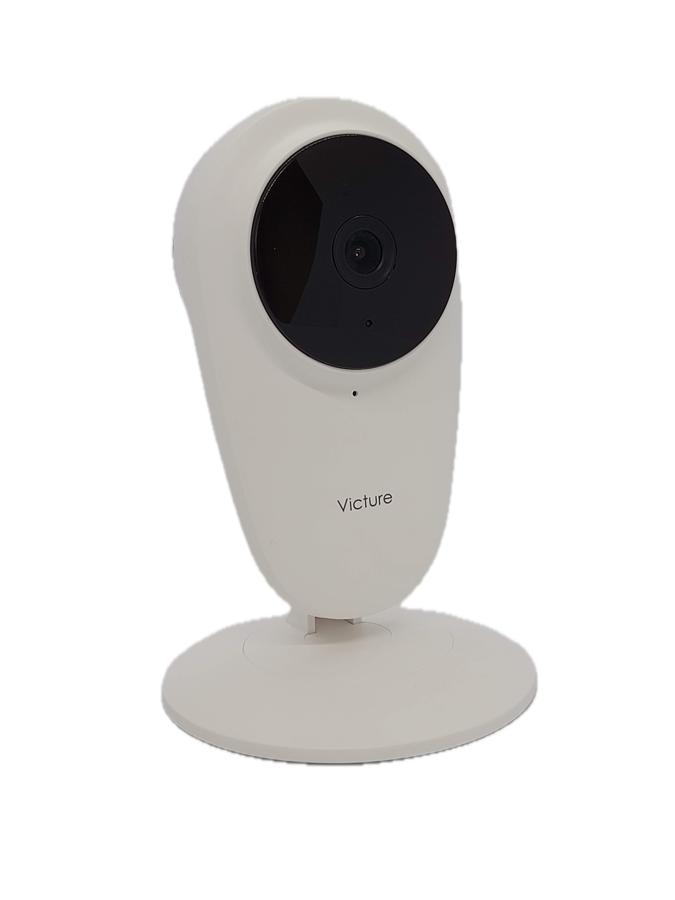

I found my Victure PC420 Baby Monitor (Wi-Fi Camera) while out thrifting and brought it home with me. I like to collect older or disused IoT devices to experiment with as it prevents me from risking expensive, new devices unless I absolutely have to. In this case, the camera retails for only $30 on the Victure website, making it a reasonable choice for consumers and hackers alike.

The camera is a basic design with an adjustable base holding up the camera body. The design is similar to the [Nest Dropcam](https://www.ifixit.com/Device/Nest_Dropcam_Pro) but I have seen many similar designs in other similarly priced IoT cameras. There is a micro-SD card slot on the side and a USB micro-B port on the back for power. It seems that the camera also has some IR LEDs, a microphone, and speaker. A recessed reset button is also on the back next to the speaker.

# Hardware Teardown

After some failed attempts at getting into the plastic shell of the device from the bottom, I found that several small plastic clips held the two halves together. With enough force, they did pop out of place and the mainboard of the camera was attached to the front section. I disconnected the speaker cable and began the process of removing the internals to get a look at the mainboard and any secrets that it may hold.

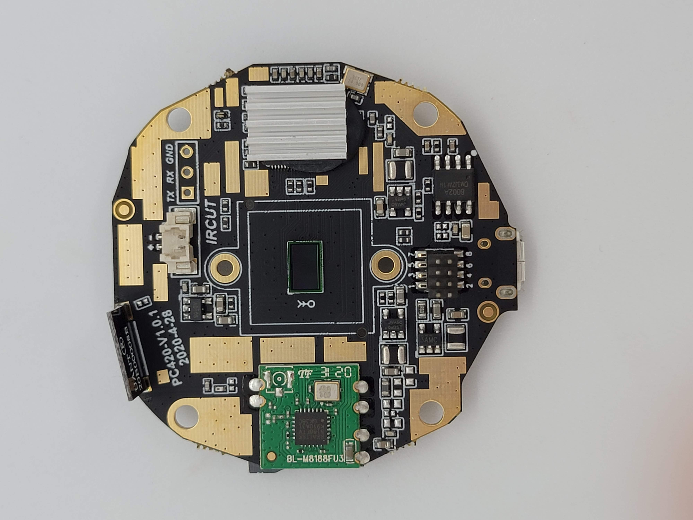
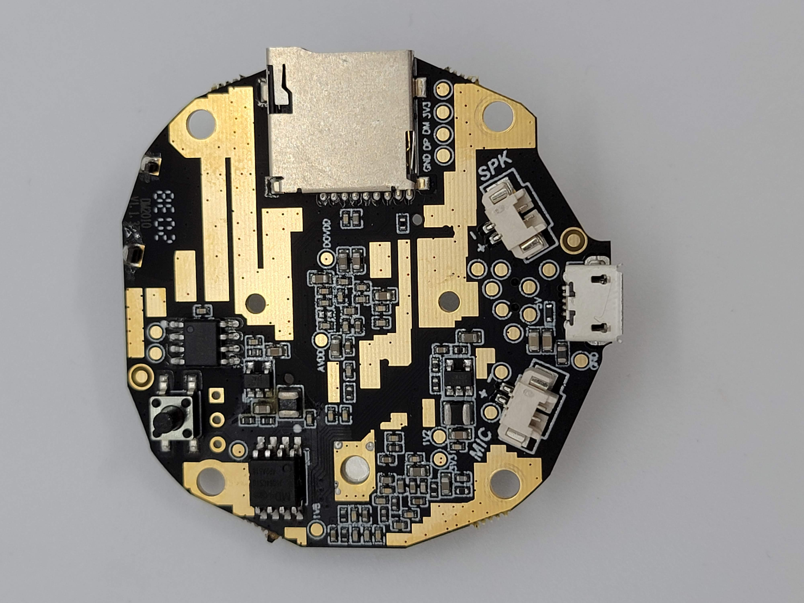

The main system-on-a-chip (SoC) of the camera is covered with a heatsink which I think is epoxied to the SoC. I also took a look and found the flash IC on the back of the board. I quickly grabbed by hot air station to desolder it and decided that I wanted to try to dump the contents using SPI. I also noted a potential UART or serial interface.

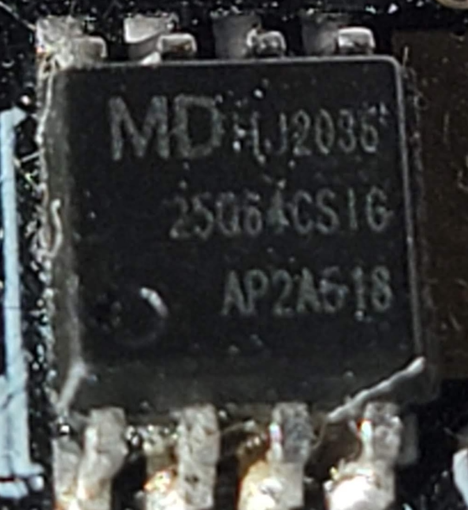

After I removed the flash IC, I found the datasheet online and found the SPI interface pinout. This is critical as the wrong pinout can damage or destroy a IC. After finding out the IC was 3.3V and connecting up my [Pomona "Chip Clip"](https://www.pomonaelectronics.com/products/test-clips/soic-clip-8-pin) following the pinout, I connected it to my [BusPirate](https://www.sparkfun.com/products/12942). The BusPirate is a handy tool that supports a variety of protocols, but SPI is what I am using it for here.

Using the tool [flashrom](https://www.flashrom.org/), I was able to, with a little bit of fiddling with the connection, dump the contents of the flash. The result was a .bin file that contained the raw firmware of the camera. I used [binwalk](https://github.com/ReFirmLabs/binwalk) to see that a valid filesystem was found in the .bin file. Now we can start reverse engineering!

# Reverse Engineering

My first step when reverse engineering is to use binwalk to see if there are any known images, filesystems, or other data and then extracting it. In this case, it was a simple unencrypted JFFS2 filesystem and I used `binwalk -e <name>` to extract it to get the directory structure and binaries out of the .bin file.

Because I used a raw flash dump of the firmware and not a firmware update file, I was able to see the configuration files as they are stored on the camera during normal use. This was due to this camera being used previously, I did find the previous user's Wi-Fi information, UID value, and UUID of the camera. This could pose a risk to user's who discard or donate devices where a dedicated attacker can then get access to even the most secure Wi-Fi password. Making sure to fully reset devices before getting rid of them can help prevent attacks from happening.

I began the process of exploring the system files. I mainly just randomly poke around the firmware in places I think would be interesting. /etc/ is a good place to start, along with /bin/, /usr/, and /var/. Vendors put binaries and config files in lots of different places. I noticed that /etc/passwd contained a salted password hash that I noted down to attempt to crack with Hashcat. I also noticed a large amount of references to the company Anyka and Nooie. Anyka is the SoC manufacture and Nooie sells similar IoT cameras (more about them later). After some poking around in /etc/, I found several start-up scripts that launched the anyka_ipc binary. Another hint that this was the main binary was the size, at 1.9MB, it must have something interesting inside. I then decided to launch Hashcat while I loaded up the anyka_ipc binary in Ghidra and was surprised when I got a hit after only 20 seconds!

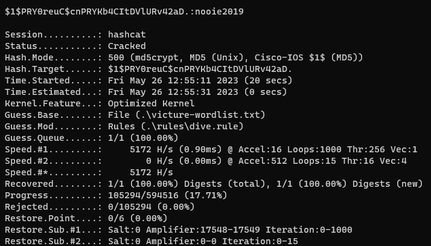

## CVE-2023-41610
### Use of hardcoded root password

The PC420 uses a hardcoded root password of `nooie2019`. This was cracked fairly quickly with Hashcat and a custom wordlist of the company names and model numbers and run with the dive ruleset. I will expand on the impact of the vulnerability later, but by default there is no way to use the root password as no telnet, SSH, or other shell is exposed from the camera.

## Ghidra

Moving on, I started looking into the anyka_ipc binary in Ghidra.

The anyka_ipc binary has functions for all kinds of tasks and almost serves as a BusyBox or RTOS function on the camera. This is common on IoT devices to save space and resources. To save time, I am going to only focus on only the functions related to the disclosed vulnerabilities.

While poking around the main function, I noticed some odd calls right away to load something from /mnt/. 

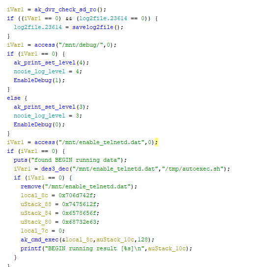

After some more digging, I was able to fairly easily reverse engineer what was going on.

## CVE-2023-41612
### Hardcoded encryption key allowing for code execution from the micro-SD card on boot

The main function within anyka_ipc checks for the mounted micro-SD card and a file named `enable_telnetd.dat`. It then attempts to decrypt the file using 3DES with a hardcoded key of `123` padded with null bytes (zeros) to the required key length of 24 bytes. It then moves the decrypted data to `/tmp/autoexec.sh` where it is run with root permissions before any other function in the binary. This gives anyone with access to the micro-SD card the ability to run code with root privileges. In the spirit of the hardcoded filename, I used this feature to enable telnetd on the camera and login using the root password I had cracked earlier. I used CyberChef to generate the file with the hardcoded 3DES key and IV values and ta-da! Telnet was open on port 23 and allowed me to login with the `root:nooie2019` credentials I cracked using HashCat.

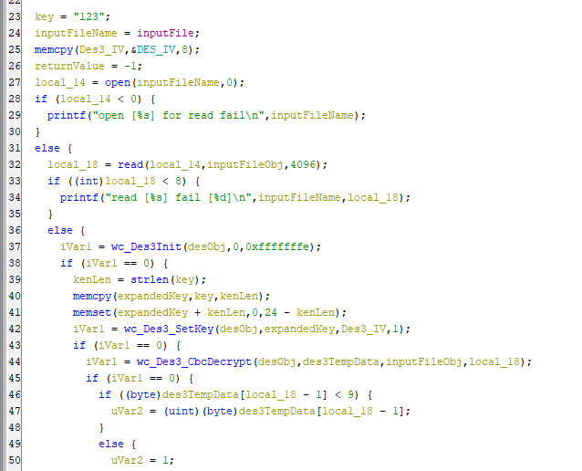

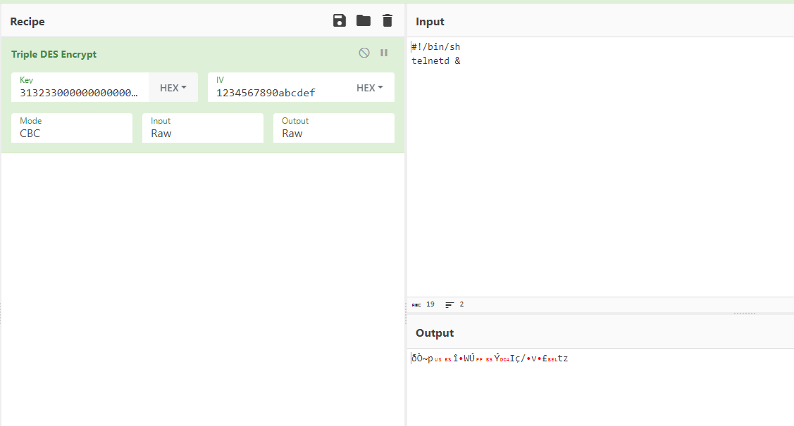

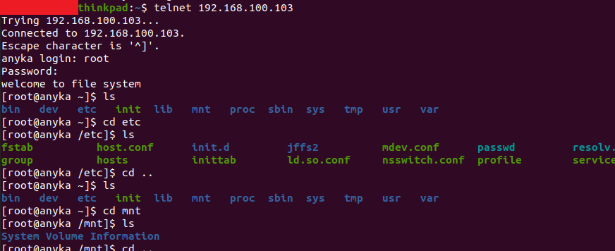

I was also able to abuse this to create a reverse shell from the camera.

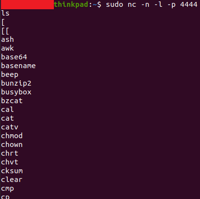

The final vulnerability I discovered took the most amount of effort to find as it is related to the encryption of certain network traffic of the camera and uses a custom encryption scheme.

## CVE-2023-41611
### Weak and partially hardcoded encryption key used to encrypt sensitive data such as username, password.

In addition to this, video and audio data from the camera is completely unencrypted. This means that anyone on the same Wi-Fi as the camera, or in a man-in-the-middle (MITM) position on the network, can view this data. 

# The Protocol - ProtoBuf and UDP

After looking at the camera's anyka_ipc binary, I found several methods referencing an RPCHeader that matched the plaintext data I saw on the network. This data was nested and used the TwoFish encryption scheme to protect the data. After finding the encoding function names, I found that the camera most likely uses the NanoPB library to encode the data using a ProtoBuf-like structure. Having never seen ProtoBuf encoding before, it took me a while to figure out how to decode the data. 

ProtoBuf uses fields and types to tell the user what the content being sent is. Using an online decoder, I was able to see the field number, type, and content of a captured message. 

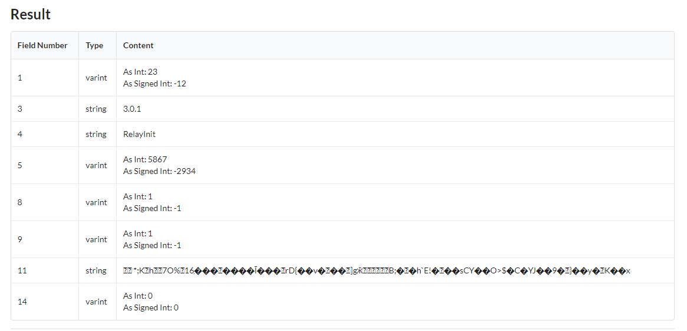

Field 11, while unreadable, contains the data encrypted with TwoFish. 

## TwoFish Encryption Key Generation

The encryption key is generated for each message sent to or from the client. The key is simply the following: `RPCHeaderMethod+RPCHeaderID+"ApEMaNSNoOiE"` with `RPCHeaderMethod` being the 4th field of the main RPC message, `RPCHeaderID` being the 5th field, and the last value being the hardcoded string. All values are concatenated together to get the TwoFish encryption key. For following messages in a chain of messages, the ID value is simply increased by 1 each time.

Going deeper, the `RPCHeaderID` value is generated from rand() which is seeded with the current time and then cut down. While the ID value is included in the parent RPC message in plaintext, it could also be brute forced fairly quickly if not included.

## The Protocol - Video and Audio data

I was also able to reconstruct a partial video frame using the raw H.265 data found during a Wireshark capture. Below is the network setup I used to simulate a MITM attack outside of the end user's network (for example, this could simulate an ISP snooping on traffic just outside of the gateway)

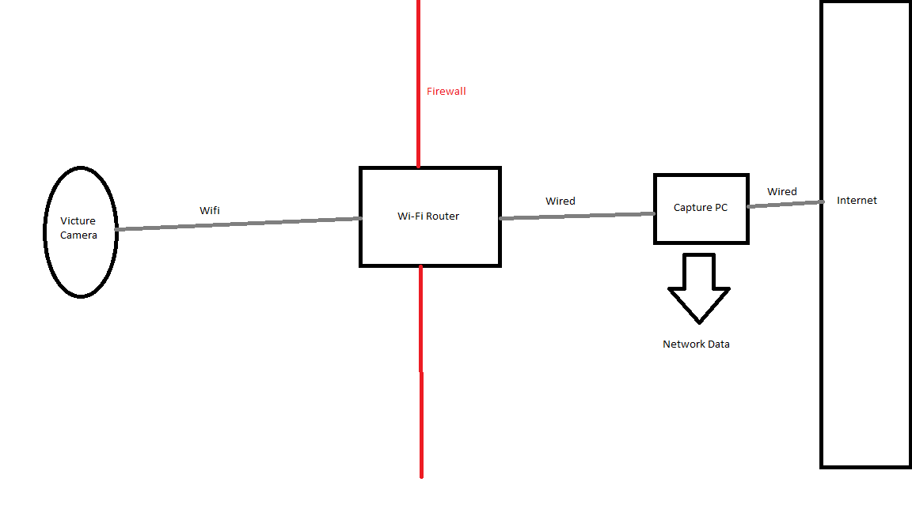

Video and audio data are sent using a custom TCP protocol that is not encrypted. After some careful review of the H.264 and H.265 protocol documentation and the anyka_ipc binary, I was able to manually decode some of the video data. The protocol uses a simple message format that is constant and includes length, media type, and other flags followed by raw video or audio data.

I wrote a very simple decoder plugin for Wireshark that displays the raw mediaData extracted from the packet. Note: the end user must choose the correct TCP port to decode. You can find it here: [https://github.com/TKems/Victure-Camera-Vulnerabilities](https://github.com/TKems/Victure-Camera-Vulnerabilities)

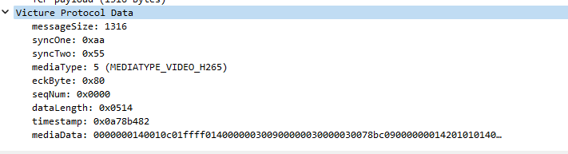

Using the plugin, I was able to manually gather several video type mediaData payloads and combine them into a single stream of data. This data then was transcoded into a MP4 container using FFMPEG to get a partial frame of data. Clearly, the timestamp of the video can be seen. 

While I thought of writing a full decoder plugin, I decided that I would let someone with more knowledge about video decoding attempt it.

### Risks of unencrypted video and audio data.

Because the camera uses Wi-Fi to communicate with the server and user's phones, it is possible for an attacker with access to the Wi-Fi network to snoop on the camera feed. It may also be possible to inject data into the video stream, just like in Hollywood!

Victure also states in their app that connections are secured with encryption (which is true when uploading files to AWS and using TLS) but as shown above, is not true for video and audio data along with RPC control data from the camera.

# MQTT

During reverse engineering, I discovered an open MQTT server that did not require authentication to view subscriptions or messages. Due to how the cameras are implemented, messages are sent to the MQTT which contain the UID and UUID values every time the camera comes online. During a 5-6 hour period, I observed over 5,000 messages and I believe that the vast majority were unique. 

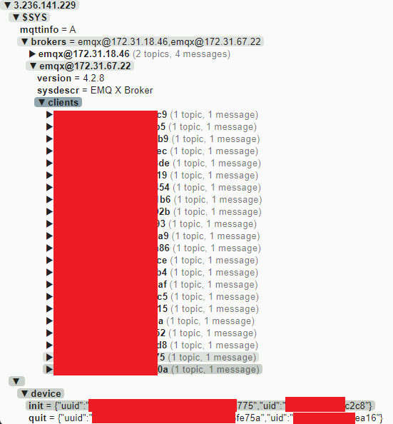

The MQTT was promptly secured by limiting the access of unauthenticated accounts after I reported the issue to Victure/Apeman.

# Android App

Victure offers an Android app to allow users to view their cameras remotely, manage their accounts, and even talk through the camera. I thought that this would have some information about the connection process that I could use in order to reverse engineer the video and audio data that was sent to and from the camera to the app. Also, with the over 500,000 downloads on Google Play, I figured that a large number of users would be still using Victure cameras with the app.

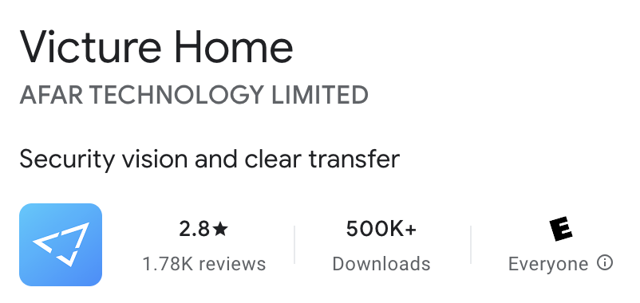

There are two ways I have found to easily get an APK from the Google Play store. 1) Find it on a mirror site like APKMirror (use at your own risk) 2) Download it onto a phone with developer mode enabled, connect over ADB shell, find the location, and download the APK file(s).

To extract the APK, I used two different tools. The most useful was [Dex2Jar](https://github.com/pxb1988/dex2jar) that allowed me to get a .jar file from the APK that contained decompiled Java code of the app. The second tool, [ApkTool](https://apktool.org/), allowed me to view the file structure of the APK file and find manifest, config, and library files. After experimenting with other tools, [JDAX](https://github.com/skylot/jadx) is much easier to use, and I have switched to using it for other projects.

I used [JD-GUI](https://java-decompiler.github.io/) to view the structure and classes of the .jar file and to search for strings and other items. Over the course of a day or two, I found several concerning items. The first was the login code. Along with network captures from an active Android app, I found that the user's password was MD5 hashed and then sent to the server. While this isn't a vulnerability by default, it is concerning that hashing occurs on the client-side. Typically, password hashing occurs on the server-side as client-side hashing provides little benefit when the connection is secured with TLS. Additionally, as with Windows Pass-the-Hash attacks, the MD5 hash is unsalted, meaning that raw MD5 hashes can be "passed" if the password OR hash is known. This concerns me as the server-side may be storing un-salted MD5 hashes of user's passwords, however, I have no evidence to prove this as I don't have access to the server-side code currently running on the server.

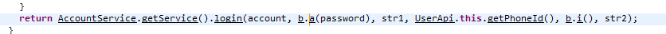
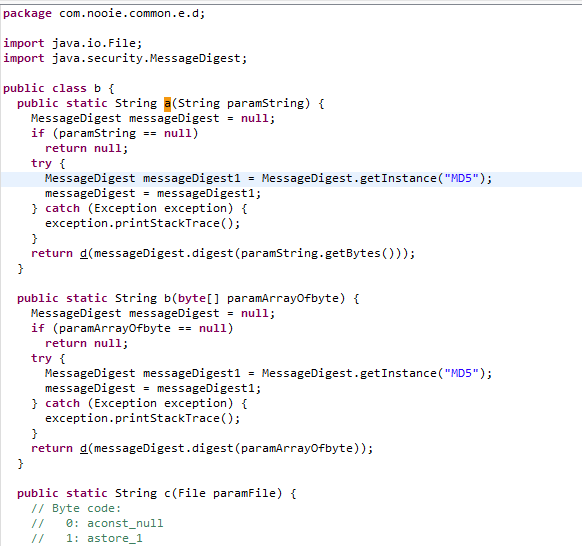

Another finding was the use of hardcoded values to sign requests to the server. HMACSHA256 is used to sign API requests to the server for what I can only guess is additional security. The HMAC secret was found to be hardcoded in both the Android app and anyka_ipc binary. This could allow an attacker with access to the UUID and UID of a user's camera to forge requests to the server. However, the Android app requests also require an api_token header assigned during login. No such header is required for the camera. Note: both the UID and UUID were viewable or constructable while connected to the MQTT server. Since the MQTT server has been secured, I was unable to gain UUIDs and UIDs of other cameras.

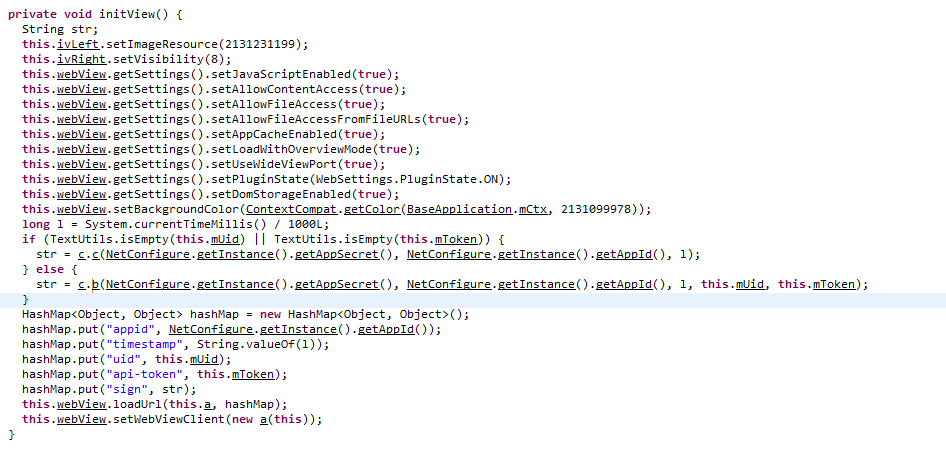

# Company Relationships 

### Victure, Nooie, and Apeman
During my investigation into Victure and their products, I found several references to other companies. As with the hardcoded password and keys, Nooie and Apeman both showed up several times. While looking into both companies, I found several clues that lead me to believe that all 3 companies are related, working closely together, or may even be owned by the same entity.

Nooie seems to be a sibling of Victure as several of the underlying technologies are shared between them. I found that the camera administration login both are based on Nooie-branded pages. I also found several references to Nooie within the code during reverse engineering.

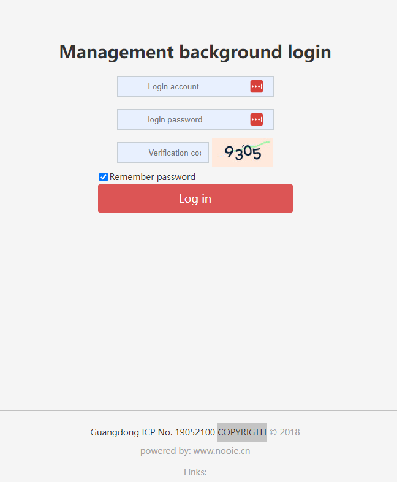

I also found that the FCC ID reports are signed by the same individual with the same email domain listed for both Nooie and Victure products listed under the Apeman brand.

Victure PC420 Camera FCC ID info (from FCCID.io): [https://fccid.io/2AWNK-PC420](https://fccid.io/2AWNK-PC420)

Nooie Device Info (from FCCID.io): [https://fccid.io/2ARER](https://fccid.io/2ARER)

Additionally, the individual I was instructed to contact about the vulnerabilities had an apemans.com email address.

To further confirm the relationship, I purchased a [Nooie 360 Cam from Amazon](https://www.amazon.com/360-degree-Wireless-Security-Tracking-Detection/dp/B07PJ67CKC). The camera is highly rated and is likely used by many as a baby monitor (the main use case listed on the Amazon page and product literature).

While I didn't invest the amount of time testing this camera as I did the Victure one, I found that the network traffic of the Nooie 360 Cam was extremely similar. I feel confident that the video and audio data are not encrypted.

A WireShark capture of the Nooie 360 Cam
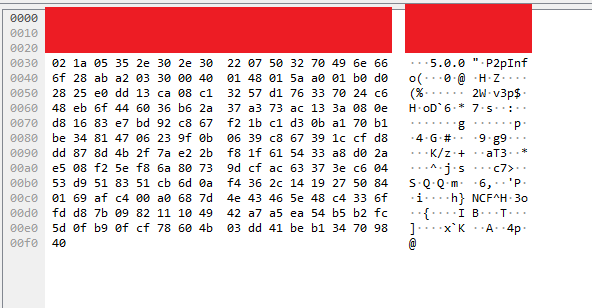

A similar capture from a Victure camera
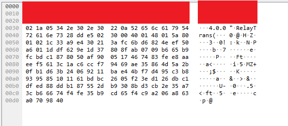

# Open Gitlab Repos 
After connecting the dots with Victure, Nooie, and Apeman, I conducted some basic OSINT against the 3 companies. During a simple Google search for Apeman and the word "git", I identified a Gitlab instance that contained several public repositories. After some investigation, I found that some of the repos contained AWS secret keys, usernames, passwords, and Go code for what potentially was the backend infrastructure. I immediately emailed my contact at Victure to confirm if Apeman and Victure were related and after confirmation, I sent a basic summary of the risks of the open repos and the URL along with a recommendation to change all AWS keys, passwords, and other sensitive information within the public repos. Several of the repos were private within hours of my report, and within a few days the site now returns a 403 response when I try to visit it.

I would like to note that I made no attempt to confirm the validity of the AWS secret keys, passwords, or other found sensitive information beyond what context I was able to gather from the code and config files within the Gitlab repos. While some keys seemed to be debug or development keys, others looked like potentially production keys.

# Reporting the Vulnerabilities to Victure/Apeman

I emailed Victure first on June 5th, 2023 and noted that I had vulnerabilities to report. On June 16th, 2023, after discussions about the security of sending the report over email, I provided Victure with the vulnerability report which contained details of the above findings. Victure responded that the MQTT server was fixed on July 18th, 2023 and that it would be until at least September 20th, 2023 before the other fixes would be finished. In the end, due to the discovery of the public Gitlab repos, I opted to wait until at least early 2024 to make the information public and to allow Victure, Apeman, and Nooie time to take actions to fix the further findings. I also planned on submitting these findings for DEFCON 32's CFP, but had other obligations that prevented me from doing so.

Overall, Victure has been accepting of my report and asked several clarifying questions in order to fix the vulnerabilities.

# Fixes
Of the vulnerabilities identified, I found that the SD Card and hardcoded root password issues were fixed within an updated firmware file provided to me by Victure. I found that the video data was not encrypted on the new firmware along with the ProtoBuf data also using the same encryption method and key structure.

# Protection of Sensitive Information
During investigation and discovery of the identified vulnerabilities, every reasonable action was taken to avoid the disclosure of potentially sensitive customer information. While only the specific Victure and Nooie cameras owned by me were tested during MITM capture, due to the peer-to-peer nature of the camera protocol, there is no guarantee that other customer data may be captured or viewed by 3rd parties. 

As stated above, I did not test the found AWS credentials or any other sensitive information (such as passwords to services) found within the Gitlab repos. I have not received a response from Victure/Nooie/Apeman regarding these fixes.

# Conclusion
As demonstrated in several other conference talks, blog articles, and news reports, IoT cameras can pose a security threat to those that use them. Currently there is little to no regulation surrounding the security of cameras outside of limiting their use in government buildings. Use of P2P (peer-to-peer) protocols can lower costs to sellers while simultaneously introducing an unknown risk to customers.

# Future Work
While these vulnerabilities I've identified are significant, I believe that further research into IoT cameras will show weaknesses within popular IoT camera firmware that have similar features.

# Related Talks/Presentations
[DEF CON Safe Mode - Paul Marrapese - Abusing P2P to Hack 3 Million Cameras](https://www.youtube.com/watch?v=Z_gKEF76oMM)

